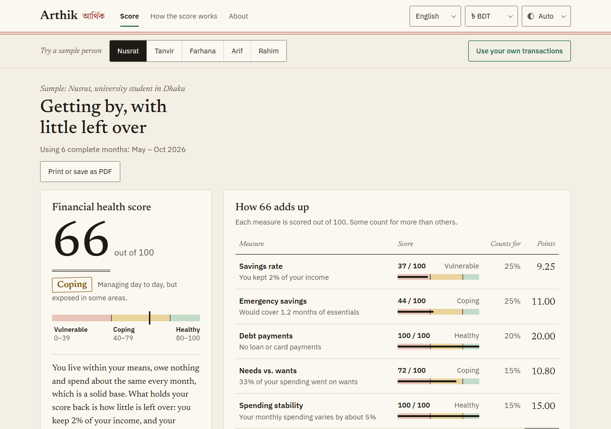
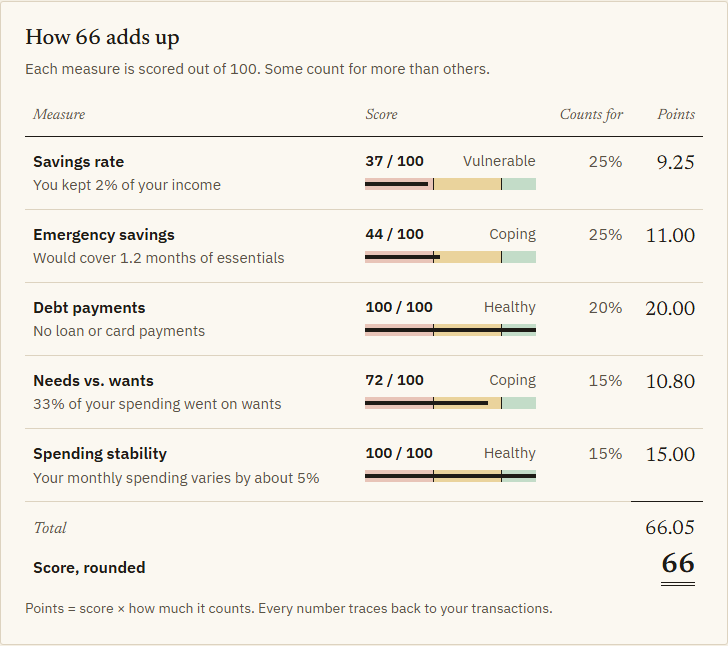
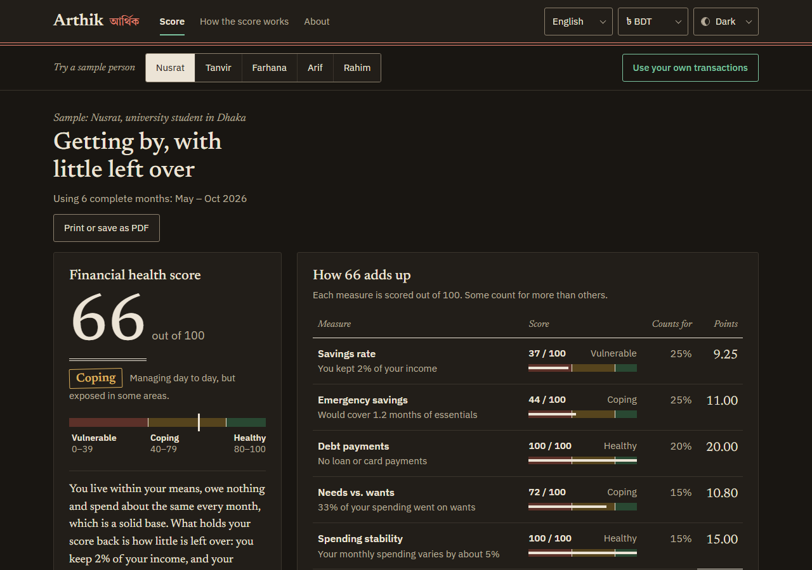
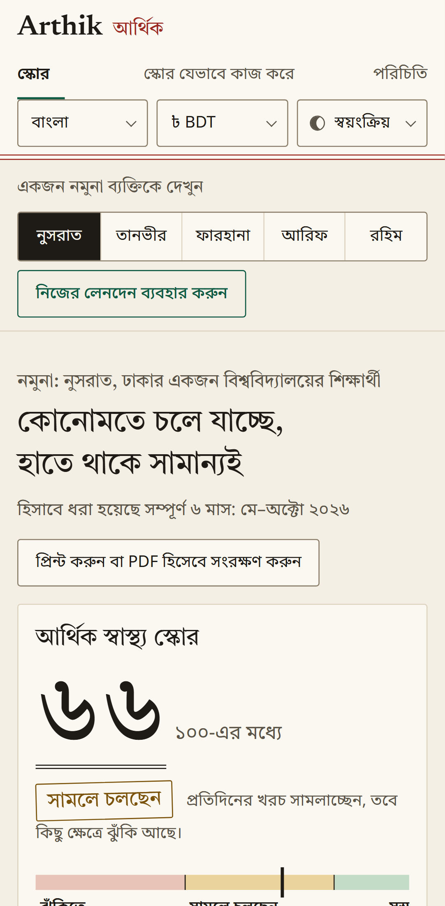
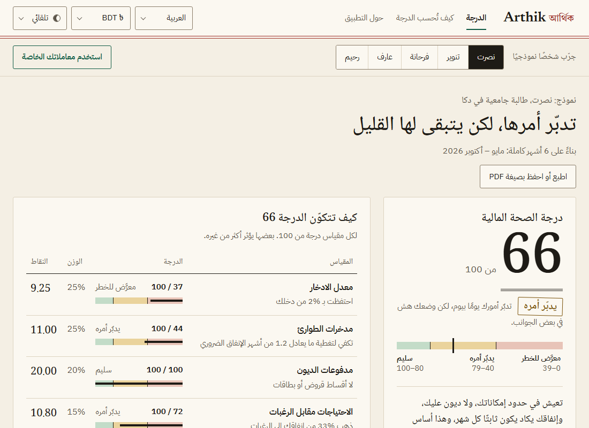
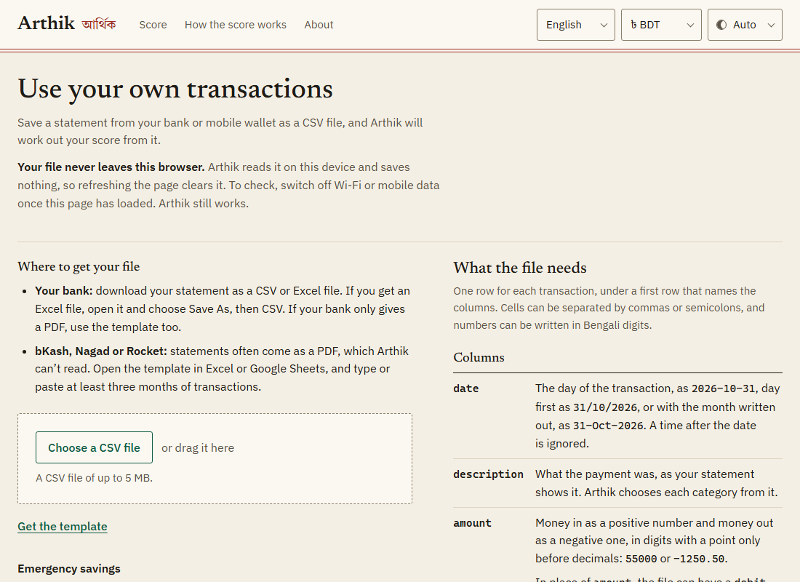

# Arthik (আর্থিক)

**Try it:** https://rubayetrezwan.github.io/arthik/

[](https://github.com/rubayetrezwan/arthik/actions/workflows/ci.yml)

Open a sample person or upload a CSV, and see a score explained point by point. Source: https://github.com/rubayetrezwan/arthik

The method is written up in [METHODOLOGY.md](METHODOLOGY.md), and the design notes are in [docs/how-it-works.md](docs/how-it-works.md).



Arthik reads a CSV of your bank or mobile-wallet transactions and gives a Financial Health Score from 0 to 100. Then it tells you why you got that score and what would raise it. The number comes from documented formulas, never from an AI model, and everything runs in your browser. Your file is not uploaded and nothing is saved.

I'm Rubayet Rezwan. I built this while applying for an MSc in Financial Technology. I wanted a score where every point traces back to a person's own numbers. Arthik is Bengali for "financial". BDT is the default currency, Bengali is a full language, and the sample data uses local patterns: bKash cash-out fees, DESCO bills, Deposit Pension Scheme (DPS) savings.

Arthik is an educational tool. It is not financial advice and not a credit score.

## How the score works

The score is inspired by the Financial Health Network's FinHealth Score, using the three bands it uses: Vulnerable (0 to 39), Coping (40 to 79) and Healthy (80 to 100). The FinHealth Score is survey-based; Arthik uses five measures you can calculate from transactions. Each becomes a sub-score from 0 to 100 by straight-line steps between anchor points.

| Measure | Weight | Formula | Anchors (value gives sub-score) |
|---|---|---|---|
| Savings rate | 25% | (Income - Spending - Debt payments) / Income | -10% gives 0, 0% gives 30, 10% gives 70, 20% or more gives 100 |
| Emergency savings | 25% | Emergency savings / average monthly Essentials (months) | 0 gives 0, 1 gives 40, 3 gives 80, 6 or more gives 100 |
| Debt payments | 20% | Debt payments / Income | 0% gives 100, 10% gives 90, 20% gives 70, 36% gives 30, 50% or more gives 0 |
| Needs vs. wants | 15% | Wants / (Essentials + Wants) | 20% or less gives 100, 30% gives 80, 40% gives 50, 60% or more gives 0 |
| Spending stability | 15% | Standard deviation / mean of monthly spending | 0.10 or less gives 100, 0.25 gives 60, 0.50 or more gives 0 |

The score uses the most recent complete months in your data, up to 12. The first month counts only if the data starts on or before the 7th, and the last only if it reaches the final 7 days. If a measure can't be calculated (no savings entered, fewer than 3 months), it shows "Not scored" and its weight is shared among the others, and the score page says "Based on N of M measures". For an uploaded file with no emergency savings, the score page has a field to add them there. The full method, with every rule and limitation, is in [METHODOLOGY.md](METHODOLOGY.md).

### The ledger

Every score is shown as a ledger, like an account book. Each row has the measure, your own number, its sub-score with a bar, how much it counts, and the points it earns. The points add up to the total, double-ruled at the bottom. Points are held as whole hundredths, so the column always sums exactly to the score on screen.



Below the ledger are the three measures with the most points to gain ("Worth up to N more points"), two to four tips (chosen by rules from your own numbers; the checks on your data, such as uncategorised spending or income Arthik doesn't recognise, always keep their place; a tip to save on payday is offered only when your savings rate is zero or above, and its amount is what you would need to not spend each month to reach the full-points savings rate), and three what-if sliders (cut wants, earn more, add to emergency savings) that show the new score without touching your data. Every number in these explanations is filled in from the calculation, never typed into the text, so the words can't disagree with the chart.

## Privacy

- Your transactions are read and scored in your browser. They are never uploaded, and nothing is stored, not even on your own device. Refresh the page and they are gone.
- There are no accounts, no analytics and no cookies, and the site makes no network requests except to load its own files.
- That is enforced as well as promised: the page carries a Content-Security-Policy that limits scripts, styles, fonts, images and requests to the site's own origin, so the browser blocks any request to another site. A browser test (`e2e/privacy.spec.ts`) checks that the policy is in the built page, that the app runs under it with nothing blocked, and that a request to another site is refused.
- The only things remembered on your device are your language, currency and light or dark theme choice.
- There are no live AI calls. Exchange rates are a dated snapshot bundled with the site.

## Install it, use it offline

Arthik is a progressive web app. Your browser can install it to the home screen or desktop, and after the first visit it opens with no network. The app, the five sample people and the translations are cached. Fonts for a language are downloaded the first time you use that language and kept after that. Nothing you upload is cached, so a file you bring is never stored. Visit once while online first; a language you haven't opened yet needs a connection the first time.

## Seven languages, eleven currencies

English is the default. The site also runs in Bengali, Hindi, Arabic (full right-to-left layout), Chinese (Simplified), Spanish and French. BDT is the default currency, with USD, EUR, JPY, GBP, CNY, CHF, AUD, CAD, HKD and SGD. BDT amounts use South Asian digit grouping (৳1,50,000). Because every measure is a ratio, switching currency never changes the score.

The theme (light or dark) follows your device unless you switch it in the header. The score page has a print layout, so you can print your score sheet or save it as a PDF.






## Five sample people

Nusrat (a student in Dhaka), Tanvir (a freelance developer paid in USD), Farhana (an office worker in Dhaka), Arif (a Bangladeshi MSc student in the UK) and Rahim (a construction worker in Singapore). They are fictional, each with six months of generated transactions. The home page shows each person's score. The home page shows each person's score. They land in all three bands. That is the point: the score measures habits, not income. Farhana has nearly three times Nusrat's money coming in and scores lower. Rahim sends at least 40% of his pay home and still scores highest. The tests pin each person to a score range, and the numbers are in [METHODOLOGY.md](METHODOLOGY.md).

## Bring your own data

Upload a CSV with a date, a description and either an amount or separate debit and credit columns. Optional `currency` and `category` columns are read too.

- Common bank headers are understood: `Date`, `Transaction Date`, `Txn Date`, `Value Date` or `Posting Date`; `Description`, `Particulars`, `Narration`, `Transaction Details`, `Details` or `Remarks`; `Debit` or `Withdrawal` and `Credit` or `Deposit`. If a file has more than one name for the same column, the first in that order is used.
- Dates can be `2026-10-31`, `31/10/2026` or `31-Oct-2026`. A time of day after the date is ignored. Month-first dates such as 10/31/2026 are refused.
- Semicolon-separated files, a byte-order mark and Bengali digits are fine.
- The upload page has a "Try it with our example file" button and a template. Wallet statements often come as PDF, which Arthik does not read, so copy the figures into the template.
- Emergency savings can be entered with the file or later on the score page.
- Errors name the row and say what to fix. Arthik refuses to guess: two columns with the same meaning, or an unsigned amount beside a debit column, are errors rather than guesses.

Categories are guessed from a built-in list of merchants and keywords, and you can change any of them in the transactions table; the score updates straight away.



## Tech stack

React 19, TypeScript and Vite. react-intl for translations, react-router, PapaParse for CSV, CSS modules with logical properties so Arabic mirrors properly. Vitest and Testing Library for unit tests, Playwright for end-to-end tests: the main flows run on desktop Chrome, Firefox and Safari, iPad (both ways), Android and iPhone profiles. The other suites run on desktop Chrome: axe-core checks for serious or critical accessibility problems (English and Arabic, every page), a check that nothing scrolls sideways at 320 to 1920px (English, Bengali and Arabic), the language tests and the offline tests. The scoring code in `src/domain/` is plain TypeScript with no React or DOM.

## Run it

You need Node.js 24 or newer.

```bash
npm ci                 # install
npm run dev            # dev server
npm test               # unit tests
npm run test:e2e       # browser tests (run npx playwright install first)
npx playwright test --grep @screenshots --project=desktop-chrome   # redo the README pictures (add --project=android for the mobile one)
npm run build          # type check and production build
npm run gen:samples    # regenerate the sample people
npm run rates:update   # refresh the exchange-rate snapshot (needs network)
```

Other scripts: `npm run lint`, `npm run typecheck` and `npm run translations:review`, which builds a review page for the translations.

## Deploy it

GitHub Actions tests every change and publishes the site to GitHub Pages under `/arthik/`. A run can also be started by hand from the Actions tab.

It can also run on Render as a free static site. `render.yaml` is a Render Blueprint: in Render, choose New → Blueprint, pick this repository, and it builds with `BASE_PATH=/` so the app is served from the root of its onrender.com address. Any other static host works the same way: run `BASE_PATH=/ npm run build` and serve the `dist` folder.

## Project structure

```
src/domain/     scoring: anchors, measures, score, categories, CSV, what-if, tips
src/data/       sample people, merchant list, exchange-rate snapshot
src/i18n/       seven message files, formatting, per-script fonts
src/pages/      the screens
src/components/ UI pieces
src/state/      language, currency and theme choices, and the loaded file
src/styles/     base styles and design tokens
public/         icons, share image, CSV template
scripts/        sample generator, rates updater, translation review
e2e/            Playwright tests
docs/           how-it-works guide, design document, screenshots
.github/        the CI and deploy workflow
render.yaml     Render Blueprint
.nvmrc          Node version
basePath.ts     the base path (/arthik/ or /) for the build
METHODOLOGY.md  the full scoring method
```

For the architecture, the decisions behind it and common questions, see [docs/how-it-works.md](docs/how-it-works.md).

## Built with Claude Code

I built Arthik with Claude Code. The five sample people's written summaries and all the translations beyond English were also written with Claude's help. I reviewed the Bengali myself. Hindi, Arabic, Chinese, Spanish and French were checked by a second AI pass, not yet by native speakers, so corrections are welcome. The score itself is plain, tested arithmetic.

## Limitations and ideas

- Only three of the four FinHealth pillars are covered. "Plan" can't be read from transactions.
- Credit card payments count as debt payments even when paid in full. If your file also holds the card's purchases, mark the bill payment as an own-account transfer.
- The anchor points are reasoned benchmarks, not statistically fitted.
- Spending stability looks at spending, not income.
- Automatic categories are only as good as the merchant list. Emergency savings is typed in by you.
- Not built, on purpose: bank connections or Open Banking, PDF statements, accounts, and live AI.
- Possible later: a "Can I afford it?" chat (needs a live model), more merchants, more languages.

## Licence

MIT. See [LICENSE](LICENSE). Copyright 2026 Rubayet Rezwan.
